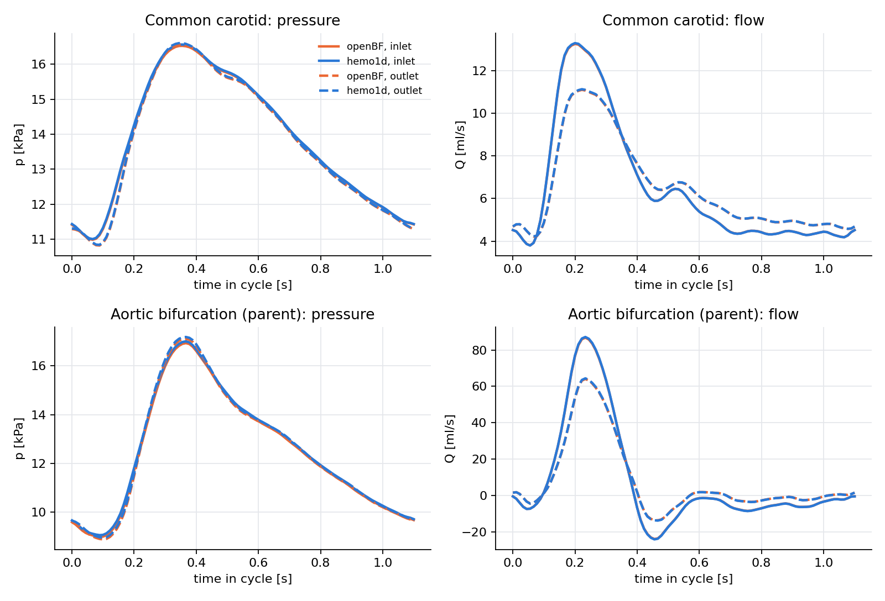
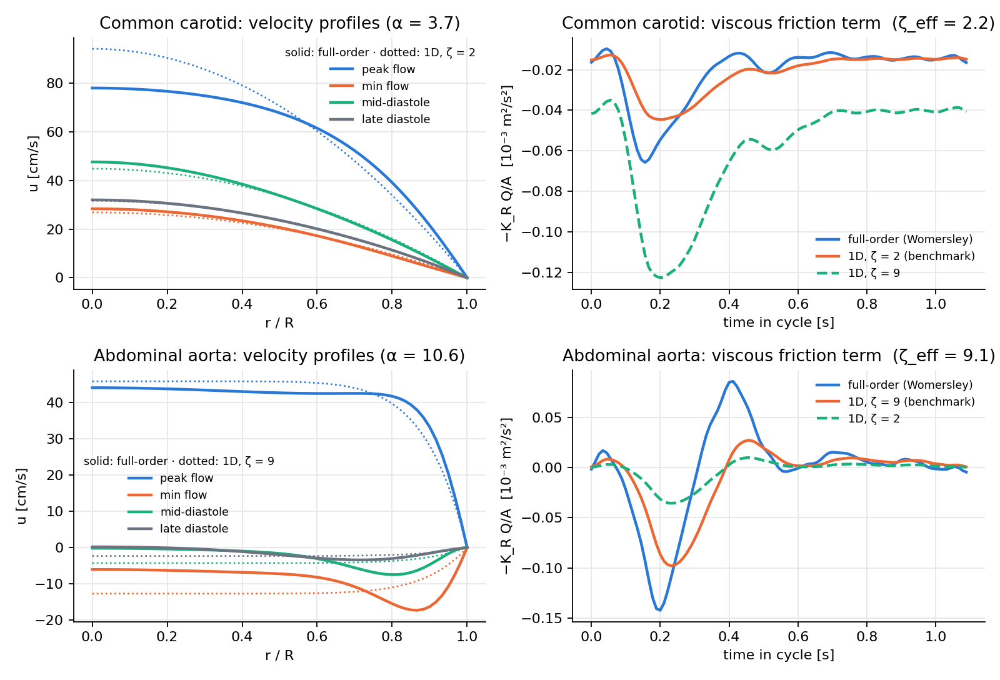

# hemo1d — reduced-order models of arterial blood flow in Python

A small, self-contained Python implementation of three rungs of the model hierarchy for arterial
blood flow, built to be compared against each other:

* a **full-order viscous model** of the axial flow in a vessel — the axisymmetric Navier–Stokes
  equations for pulsatile flow (Womersley regime), solved analytically and by finite differences;
* the classical **one-dimensional (area–flow) model of a compliant vessel**, with the boundary and
  junction treatments of the 1D-hemodynamics literature;
* a **0D (lumped Windkessel) counterpart**.

It reproduces two cases of the Boileau et al. (2015) benchmark with the benchmark's own inflow data,
agrees with the open-source solver openBF to within 1 % of the pulse pressure, ships analytical
**verification tests**, and has a **Streamlit explorer**.

Built as a preparation exercise for the CIMPA Collaborative Workshop group
*"Reduced and full-order models for hemodynamics: numerical simulation, comparison, and analysis"*
(A. Buffa, F. Sala — University of Neuchâtel, January 2027).

| | |
|---|---|
|  |  |
| Common carotid (Boileau et al. 2015 parameters) | Aortic bifurcation: waves through a junction |
|  |  |
| Cross-code check: hemo1d vs openBF on the benchmark cases | Full-order (Womersley) vs the 1D viscous closure |
|  |  |
| 1D vessel + RCR vs. 0D lumped model at the inlet | Mesh convergence against a 320-cell reference |

## Model

For each vessel, with cross-sectional area `A(x,t)` and flow rate `Q(x,t)`:

```
∂A/∂t + ∂Q/∂x = 0
∂Q/∂t + ∂(Q²/A)/∂x + (A/ρ) ∂p/∂x = −K_R Q/A ,      K_R = 2(ζ+2)πμ/ρ
p(A) = p_ext + (β/A₀)(√A − √A₀) ,                    β = (4/3)√π E h
```

The system is hyperbolic with wave speed `c(A) = √(β/(2ρA₀)) A^{1/4}` and Riemann invariants
`W₁,₂ = u ± 4(c − c₀)`, which are used for every boundary:

* **inlet**: prescribed `Q(t)`, area from the incoming invariant `W₂`;
* **outlet**: 3-element **Windkessel (RCR)** solved implicitly together with the outgoing
  invariant `W₁` (trapezoidal rule for the 0D ODE), or a non-reflecting condition;
* **bifurcation**: six unknowns `(A,u)` at the parent outlet and the two daughter inlets, from
  conservation of mass, continuity of total pressure `p + ρu²/2`, and the three characteristic
  equations, solved by Newton's method.

Interior scheme: two-step **Lax–Wendroff** (Richtmyer) with the friction term integrated
alongside, explicit in time with a CFL condition.

The **0D reference** collapses the vessel into the Windkessel by adding its wall compliance
`C_v = L · dA/dp|A₀` to the capacitor — the coarsest rung of the model hierarchy that the
workshop group proposes to compare (3D FSI → 1D → 0D).

## Full-order model: the radial velocity profile (`hemo1d/womersley.py`)

For fully developed pulsatile flow in a straight rigid vessel the axisymmetric Navier–Stokes
equations reduce exactly to

```
∂u/∂t = −(1/ρ) ∂p/∂z(t) + ν (1/r) ∂/∂r ( r ∂u/∂r ),   u(R,t) = 0,   ∂u/∂r(0,t) = 0,
```

which resolves the quantity the 1D model replaces by an assumption: the shape of the velocity
profile, encoded in the friction term `−K_R Q/A` through the parameter ζ (ζ = 2 Poiseuille, ζ → ∞
flat). The module provides Womersley's analytical solution harmonic by harmonic (Bessel functions),
a Crank–Nicolson finite-difference solver verified against it to 0.1 %, and a Fourier
reconstruction that, given a flow waveform `Q(t)`, returns the pressure gradient, the wall shear
stress `τ_w(t)` and the field `u(r,t)`. From `τ_w` one obtains the full-order friction per unit
length and a least-squares **effective ζ**.

**What the comparison says** (`examples/full_vs_reduced.py`, benchmark waveforms): for the common
carotid (Womersley number α = 3.7) the effective ζ is 2.2, and for the abdominal aorta (α = 10.6)
it is 9.1 — the benchmark's choices ζ = 2 and ζ = 9 are exactly what the full-order model
recommends. But even with the best ζ the quasi-steady closure misses ≈14 % (RMS, relative to the
range) of the friction term, because the full-order friction *leads* the flow in phase and, in the
aorta, the near-wall flow reverses while the core still moves forward (see the profiles in the
figure). A closure that captures this needs memory (a convolution kernel) rather than a constant ζ
— a concrete question for the workshop.

## Benchmark cases and cross-code comparison

Geometry, wall parameters, Windkessel constants **and inflow waveforms** are those of
Boileau et al., *A benchmark study of numerical schemes for one-dimensional arterial blood flow
modelling*, IJNMBE 31 (2015), taken from the model files distributed with openBF
(Benemerito et al. 2024, Apache-2.0; `data/*_inlet.dat`, `data/LICENSE-openBF`). The reference
geometry is the zero-pressure one used by openBF, equivalent to the benchmark's diastolic reference:

* **common carotid artery** (`common_carotid`): L = 126 mm, R₀ = 2.6485 mm, h₀ = 0.24 mm,
  E = 700 kPa, ζ = 2, R₁ = 2.4875·10⁸, C = 1.7529·10⁻¹⁰, R₂ = 1.8697·10⁹ (SI);
* **aortic bifurcation** (`aortic_bifurcation`): abdominal aorta (L = 8.6 cm, R₀ = 7.581 mm,
  h₀ = 0.9 mm, E = 500 kPa) → two iliacs (L = 8.5 cm, R₀ = 5.492 mm, h₀ = 0.68 mm, E = 700 kPa),
  ζ = 9, R₁ = 6.8123·10⁷, C = 3.6664·10⁻¹⁰, R₂ = 3.1013·10⁹ at each outlet.

openBF's own regression references for these cases (its `test/ref_*.jls`, produced by its
finite-volume MUSCL scheme) are exported to `data/openbf_ref_*.dat` at x = 0, L/4, L/2, 3L/4, L.
`examples/compare_openbf.py` runs hemo1d on identical inputs and compares pointwise over a cycle:

| case | pressure RMS difference | flow RMS difference |
|---|---|---|
| common carotid (inlet / mid / outlet) | 26–29 Pa, **0.5 %** of pulse pressure | 0.01–0.02 ml/s, 0.2 % of range |
| aortic bifurcation, parent vessel | 63–65 Pa, **0.8 %** of pulse pressure | 0.02–0.16 ml/s, ≤ 0.2 % of range |

hemo1d is systematically ≈ 40–70 Pa (0.3–0.5 mmHg) above openBF, at systole and diastole alike —
a constant offset of the kind produced by a slightly different Windkessel time discretisation or
reference state, not by the wave dynamics. Tracking it down is on the list.

## Verification (`python -m pytest tests -q`, ~1 min)

| test | what it checks | result |
|---|---|---|
| `test_poiseuille_pressure_drop` | steady flow with ζ = 2 reproduces Δp = 8πμLQ/Ā² | < 0.5 % |
| `test_pulse_wave_speed` | a small pulse arrives at x = L after L/c₀ (Moens–Korteweg) | < 2 % |
| `test_junction_conservation` | Q_parent = Q_left + Q_right at the bifurcation | 1e-9 |
| `test_mesh_convergence` | monotone convergence of mid-vessel pressure vs a 320-cell reference | rates 1.1 → 1.6 |
| `test_agreement_with_openbf_carotid` | inlet pressure vs openBF's reference on the benchmark carotid | < 2 % of pulse pressure |
| `test_fd_matches_womersley_analytical` | Crank–Nicolson radial solver vs Womersley's Bessel solution | < 0.1 % |
| `test_fd_steady_poiseuille` | steady limit of the radial solver | < 0.2 % |
| `test_fourier_reconstruction_and_zeta_limits` | u(r,t) from Q(t) returns Q(t); ζ_eff → 2 for slow flow | 0.5 % / ±0.1 |

**A finding worth stating plainly:** Lax–Wendroff is second order in the interior, but the
characteristic treatment of the boundaries used here (linear extrapolation of the invariants,
ghost states frozen at tⁿ) is first order, and the measured *global* rate in a cycle-averaged
L² norm is ≈1.1–1.6 rather than 2 (errors 11.1 → 5.2 → 2.2 → 0.75 Pa for 20 → 160 cells; all
below 0.1 mmHg). Raising the boundary coupling to second order — or moving to the
discontinuous-Galerkin / Taylor–Galerkin schemes compared in Boileau et al. — is the obvious
improvement, and exactly the kind of scheme comparison the workshop group is about.

## Usage

```bash
pip install numpy scipy matplotlib streamlit pytest
python examples/make_figures.py      # figures 1-4 (~3 min)
python examples/compare_openbf.py    # figure 5, hemo1d vs openBF (~2 min)
python examples/full_vs_reduced.py   # figure 6, full-order vs 1D closure (seconds)
python -m pytest tests -q            # verification tests
streamlit run app.py                 # interactive explorer
```

```python
from hemo1d import common_carotid, run_cycles, MMHG
net, vessel, windkessel, inflow = common_carotid(n_cells=100)
rec = run_cycles(net, {"carotid": [0.0, vessel.length]}, n_cycles=6)
p_inlet_mmHg = rec[("carotid", 0.0)]["p"] / MMHG
```

## Layout

```
hemo1d/model.py    Vessel: tube law, wave speed, Riemann invariants, fluxes
hemo1d/solver.py   Network: Lax–Wendroff step, inlet / Windkessel / junction coupling, 0D model
hemo1d/cases.py    Boileau et al. (2015) test cases with the benchmark inflow data
hemo1d/womersley.py  full-order axisymmetric viscous model (analytical + finite differences)
data/              benchmark inflows and openBF reference waveforms
tests/             analytical and cross-code verification
examples/          figure scripts
app.py             Streamlit explorer
```

## References

* Boileau E., Pan S., Sazonov I., Vignon-Clementel I., Alastruey J. et al. (2015). A benchmark study of
  numerical schemes for one-dimensional arterial blood flow modelling. *IJNMBE* 31(10).
* Sherwin S.J., Franke V., Peiró J., Parker K. (2003). One-dimensional modelling of a vascular network in
  space-time variables. *J. Eng. Math.* 47.
* Alastruey J., Parker K., Sherwin S.J. (2012). Arterial pulse wave haemodynamics. *BHR Group 11th
  International Conference on Pressure Surges*.
* Formaggia L., Quarteroni A., Veneziani A. (eds.) (2009). *Cardiovascular Mathematics*. Springer.
* Womersley J.R. (1955). Method for the calculation of velocity, rate of flow and viscous drag in arteries when
  the pressure gradient is known. *J. Physiol.* 127.
* Benemerito I., Melis A., Wehenkel A., Marzo A. (2024). openBF: an open-source finite volume 1D blood flow solver.
  *Physiol. Meas.* 45. https://github.com/INSIGNEO/openBF

Author: Carlos Manuel Orrego Franco — Universidad Nacional de Colombia, Manizales.
