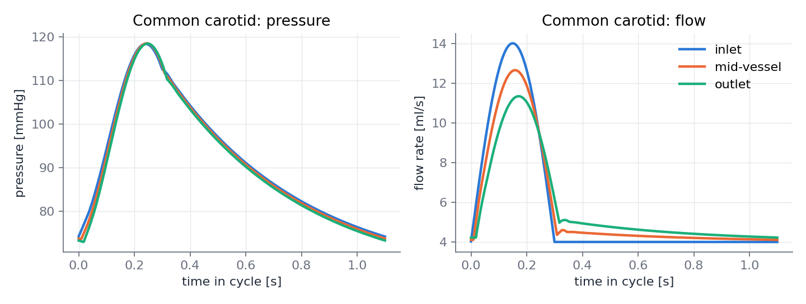
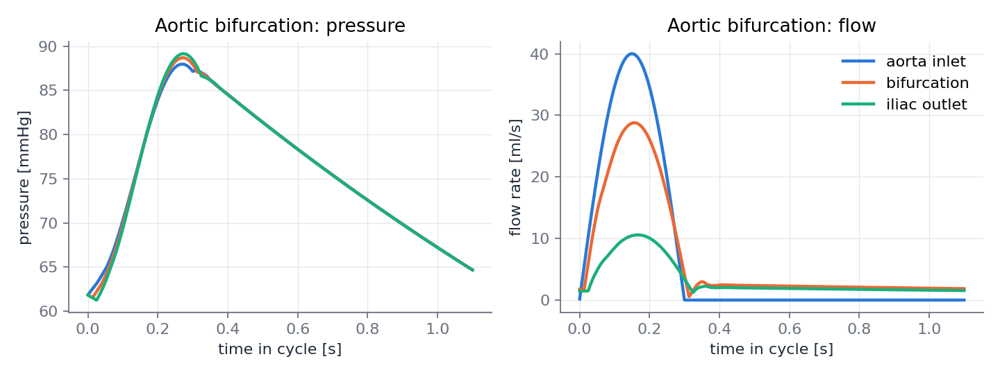
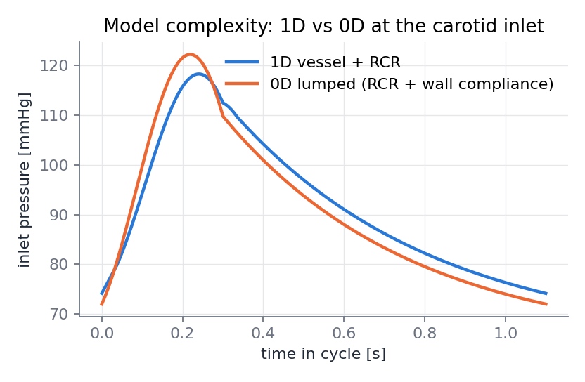
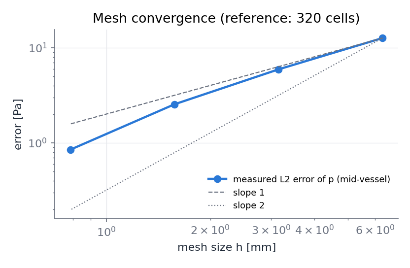

# hemo1d — reduced-order models of arterial blood flow in Python

A small, self-contained implementation of the classical **one-dimensional (area–flow) model of
blood flow in compliant vessels**, with the boundary and junction treatments used in the
1D-hemodynamics literature, a **0D (lumped Windkessel) counterpart** for model-complexity
comparisons, analytical **verification tests**, and a **Streamlit explorer**.

Built as a preparation exercise for the CIMPA Collaborative Workshop group
*"Reduced and full-order models for hemodynamics: numerical simulation, comparison, and analysis"*
(A. Buffa, F. Sala — University of Neuchâtel, January 2027).

| | |
|---|---|
|  |  |
| Common carotid (Boileau et al. 2015 parameters) | Aortic bifurcation: waves through a junction |
|  |  |
| 1D vessel + RCR vs. 0D lumped model at the inlet | Mesh convergence against a 320-cell reference |

## Model

For each vessel, with cross-sectional area `A(x,t)` and flow rate `Q(x,t)`:

```
∂A/∂t + ∂Q/∂x = 0
∂Q/∂t + ∂(Q²/A)/∂x + (A/ρ) ∂p/∂x = −K_R Q/A ,      K_R = 2(ζ+2)πμ/ρ
p(A) = p_ext + (β/A₀)(√A − √A₀) ,                    β = (4/3)√π E h
```

The system is hyperbolic with wave speed `c(A) = √(β/(2ρA₀)) A^{1/4}` and Riemann invariants
`W₁,₂ = u ± 4(c − c₀)`, which are used for every boundary:

* **inlet**: prescribed `Q(t)`, area from the incoming invariant `W₂`;
* **outlet**: 3-element **Windkessel (RCR)** solved implicitly together with the outgoing
  invariant `W₁` (trapezoidal rule for the 0D ODE), or a non-reflecting condition;
* **bifurcation**: six unknowns `(A,u)` at the parent outlet and the two daughter inlets, from
  conservation of mass, continuity of total pressure `p + ρu²/2`, and the three characteristic
  equations, solved by Newton's method.

Interior scheme: two-step **Lax–Wendroff** (Richtmyer) with the friction term integrated
alongside, explicit in time with a CFL condition.

The **0D reference** collapses the vessel into the Windkessel by adding its wall compliance
`C_v = L · dA/dp|A₀` to the capacitor — the coarsest rung of the model hierarchy that the
workshop group proposes to compare (3D FSI → 1D → 0D).

## Test cases

Geometry, wall parameters and Windkessel constants follow the benchmark of
Boileau et al., *A benchmark study of numerical schemes for one-dimensional arterial blood flow
modelling*, Int. J. Numer. Meth. Biomed. Engng. 31 (2015):

* **common carotid artery** (`common_carotid`): L = 126 mm, r = 3 mm, h = 0.3 mm, E = 700 kPa,
  R₁ = 2.4875·10⁸, C = 1.7529·10⁻¹⁰, R₂ = 1.8697·10⁹ (SI);
* **aortic bifurcation** (`aortic_bifurcation`): abdominal aorta (L = 8.6 cm, r = 8.6 mm,
  h = 1.032 mm, E = 500 kPa) → two iliacs (L = 8.5 cm, r = 6 mm, h = 0.72 mm, E = 700 kPa),
  R₁ = 6.8123·10⁷, C = 3.6664·10⁻¹⁰, R₂ = 3.1013·10⁹ at each outlet.

The benchmark's tabulated inflow waveforms are replaced here by smooth analytic half-sine
waveforms whose mean matches the mean pressure implied by the total peripheral resistance, so the
pressure ranges (74–118 mmHg in the carotid) are physiological but the shapes are illustrative.
Feeding the benchmark's actual inflow data and comparing pointwise is the natural next step.

## Verification (`python -m pytest tests -q`, ~40 s)

| test | what it checks | result |
|---|---|---|
| `test_poiseuille_pressure_drop` | steady flow with ζ = 2 reproduces Δp = 8πμLQ/Ā² | < 0.5 % |
| `test_pulse_wave_speed` | a small pulse arrives at x = L after L/c₀ (Moens–Korteweg) | < 2 % |
| `test_junction_conservation` | Q_parent = Q_left + Q_right at the bifurcation | 1e-9 |
| `test_mesh_convergence` | monotone convergence of mid-vessel pressure vs a 320-cell reference | rates 1.1 → 1.6 |

**A finding worth stating plainly:** Lax–Wendroff is second order in the interior, but the
characteristic treatment of the boundaries used here (linear extrapolation of the invariants,
ghost states frozen at tⁿ) is first order, and the measured *global* rate in a cycle-averaged
L² norm is ≈1.1–1.6 rather than 2 (errors 12.7 → 5.9 → 2.5 → 0.85 Pa for 20 → 160 cells; all
below 0.1 mmHg). Raising the boundary coupling to second order — or moving to the
discontinuous-Galerkin / Taylor–Galerkin schemes compared in Boileau et al. — is the obvious
improvement, and exactly the kind of scheme comparison the workshop group is about.

## Usage

```bash
pip install numpy scipy matplotlib streamlit pytest
python examples/make_figures.py      # regenerates figures/ (~3 min)
python -m pytest tests -q            # verification tests
streamlit run app.py                 # interactive explorer
```

```python
from hemo1d import common_carotid, run_cycles, MMHG
net, vessel, windkessel, inflow = common_carotid(n_cells=100)
rec = run_cycles(net, {"carotid": [0.0, vessel.length]}, n_cycles=6)
p_inlet_mmHg = rec[("carotid", 0.0)]["p"] / MMHG
```

## Layout

```
hemo1d/model.py    Vessel: tube law, wave speed, Riemann invariants, fluxes
hemo1d/solver.py   Network: Lax–Wendroff step, inlet / Windkessel / junction coupling, 0D model
hemo1d/cases.py    Boileau et al. (2015) test cases and analytic inflow waveforms
tests/             analytical verification
examples/          figure script
app.py             Streamlit explorer
```

## References

* Boileau E., Pan S., Sazonov I., Vignon-Clementel I., Alastruey J. et al. (2015). A benchmark study of
  numerical schemes for one-dimensional arterial blood flow modelling. *IJNMBE* 31(10).
* Sherwin S.J., Franke V., Peiró J., Parker K. (2003). One-dimensional modelling of a vascular network in
  space-time variables. *J. Eng. Math.* 47.
* Alastruey J., Parker K., Sherwin S.J. (2012). Arterial pulse wave haemodynamics. *BHR Group 11th
  International Conference on Pressure Surges*.
* Formaggia L., Quarteroni A., Veneziani A. (eds.) (2009). *Cardiovascular Mathematics*. Springer.

Author: Carlos Manuel Orrego Franco — Universidad Nacional de Colombia, Manizales.
